# 🍳 Culinary Creations

> Organize, view, and edit your favorite recipes with ease. Create, customize, and save delicious dishes anytime, anywhere.

**Culinary Creations** is a recipe management app for Android. Browse recipes by category, save your favorites, add your own dishes with photos, and edit them later, in a light or dark theme with adjustable font size.

*Version 1.0 · Created by Anamaria, Marius and Bogdan*

---

## ✨ Features

- **Home feed**: search bar, a "Newest Recipes" carousel, category shortcuts, and personalized recipe suggestions
- **Browse by category**: Main Course, Dessert, Snacks, and more
- **Recipe details**: author, description, prep / cook / total time, and a full ingredients list
- **Favorites**: tap the heart on any recipe to save it to your favorites list
- **Add recipes**: name, description, photo, category, and more
- **Edit recipes**: pick an existing recipe and update its name, description, category, theme, ingredients, and steps
- **Light & dark theme**: switch instantly from Settings
- **Adjustable font size**: with a live preview
- **Flyout navigation**: quick access to every section from the menu

---

## 📱 Screenshots

*Captured on the Android Emulator (Pixel 7, API 35).*

### Home

Search for recipes, check out the newest additions, jump into a category, or explore suggestions.

| Light | Dark |
|:---:|:---:|
| 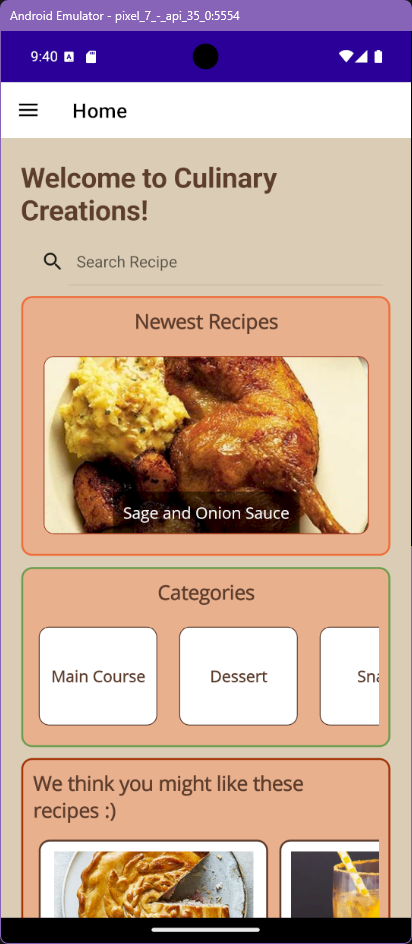 | 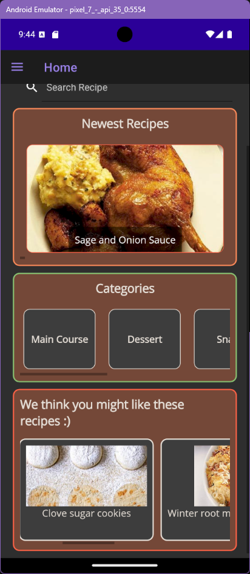 |

### Browsing & Recipe Details

Open a category to see its recipes, then tap one for the full details.

| Category list | Recipe details |
|:---:|:---:|
| 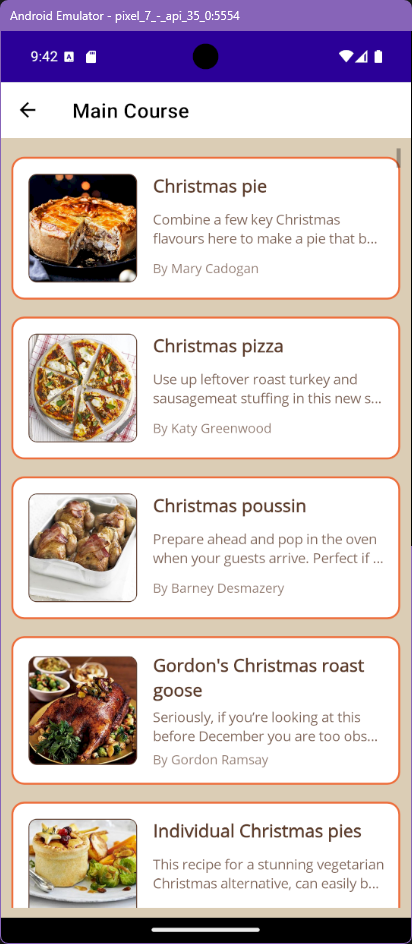 | 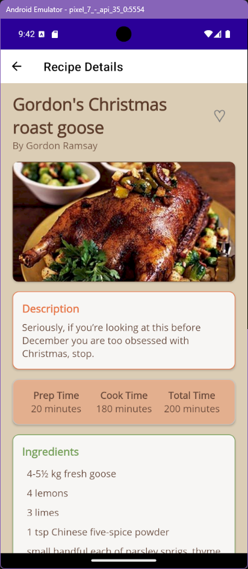 |

### Favorites

Every recipe you've hearted, in one place.

| Light | Dark |
|:---:|:---:|
| 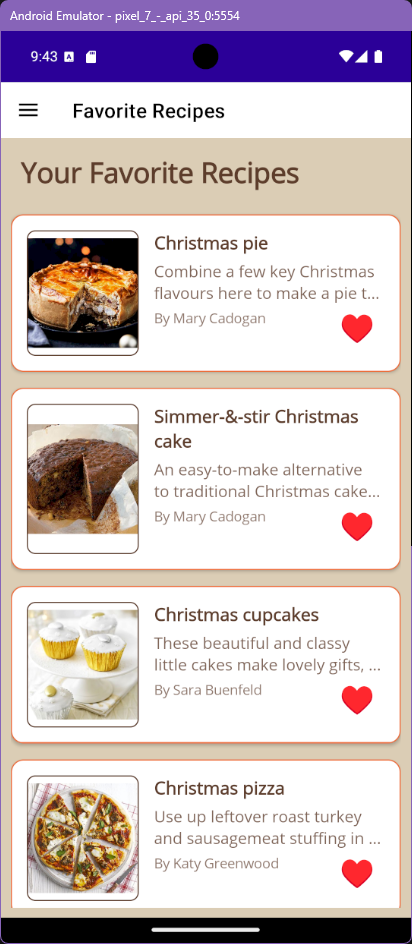 | 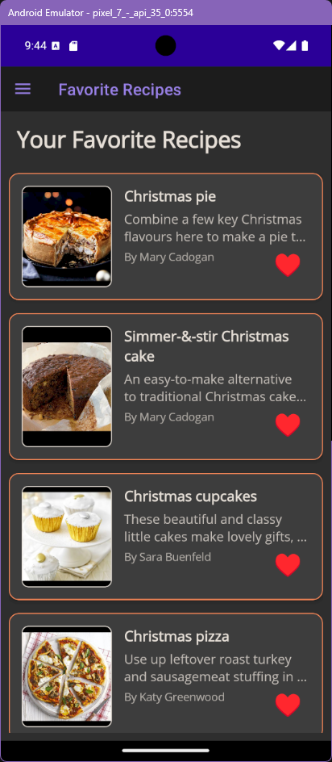 |

### Add a Recipe

| Light | Dark |
|:---:|:---:|
| 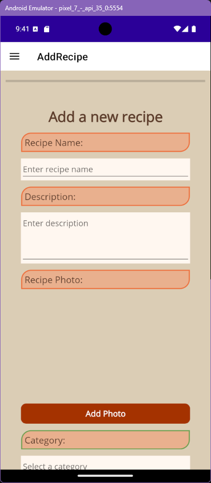 | 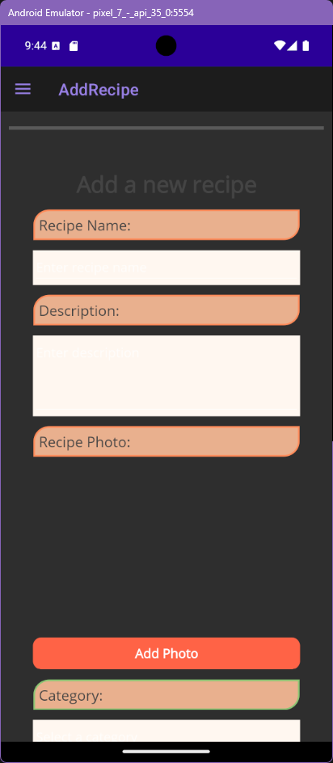 |

### Edit a Recipe

Select a recipe and the form fills in with its current details, ready to edit.

| Empty form | Recipe loaded |
|:---:|:---:|
| 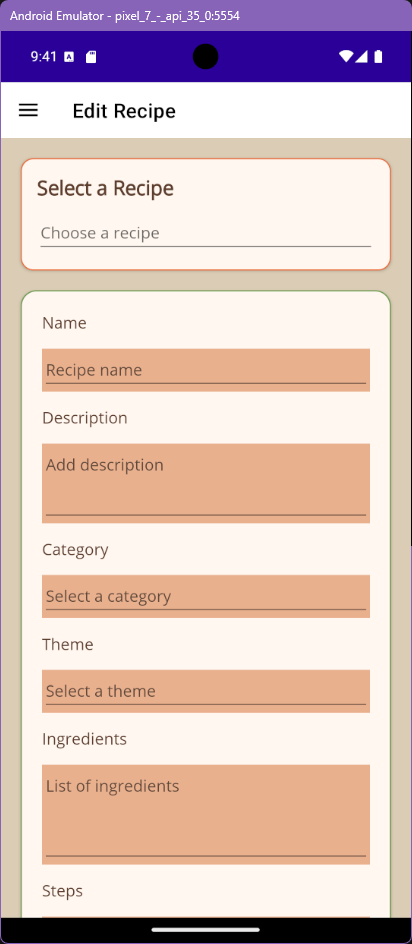 | 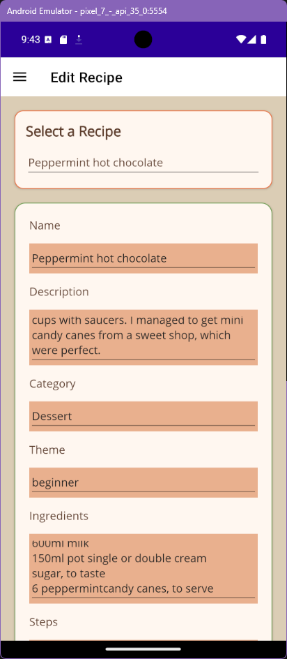 |

### Settings

Toggle between light and dark themes and pick a font size.

| Light | Dark |
|:---:|:---:|
| 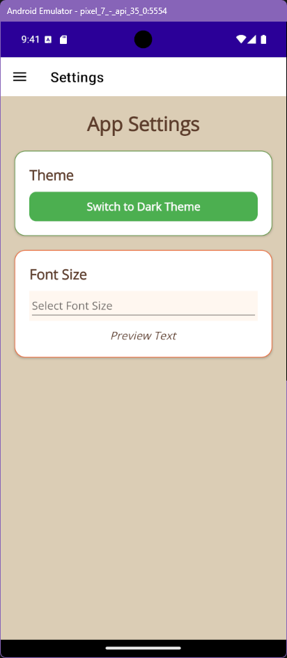 | 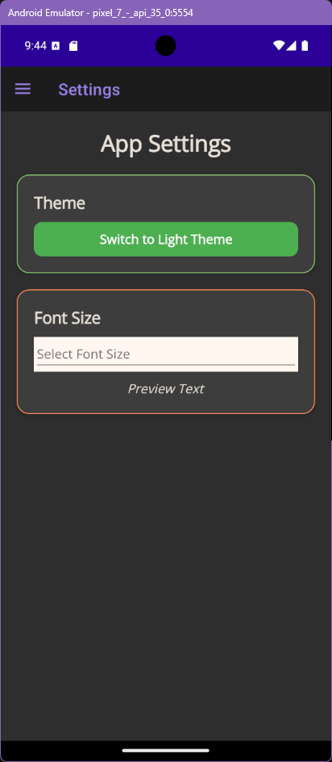 |

### About

| Light | Dark |
|:---:|:---:|
| 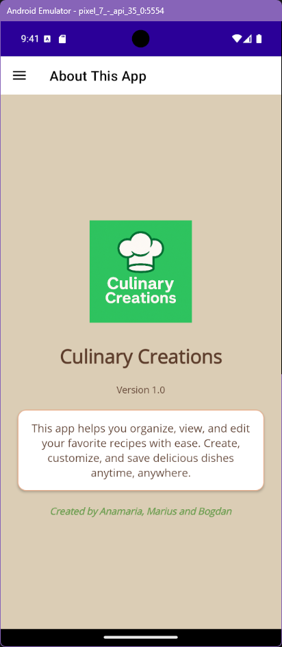 | 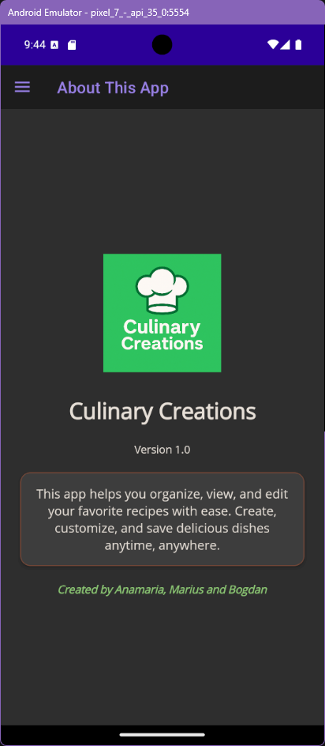 |

---

## 👩‍🍳 Authors

Created by **Anamaria**, **Marius** and **Bogdan**.
